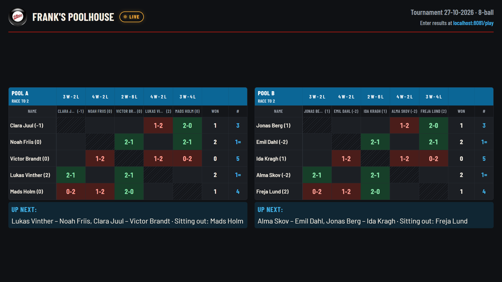
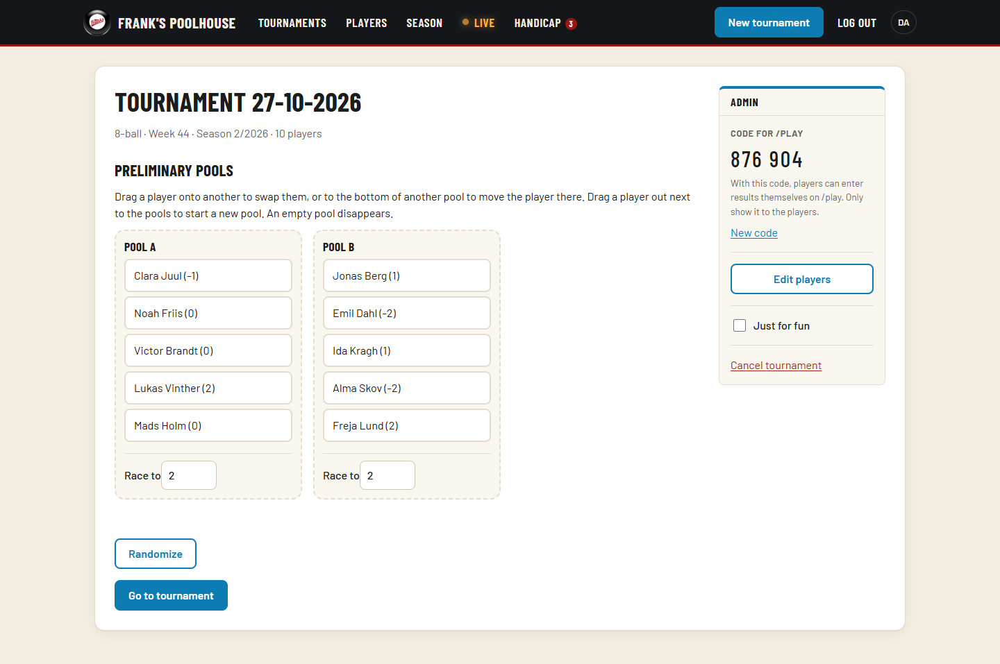
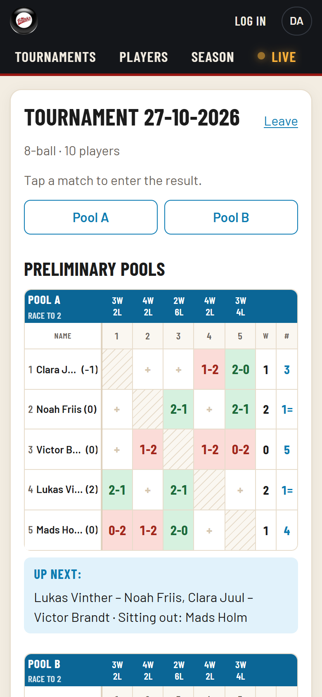
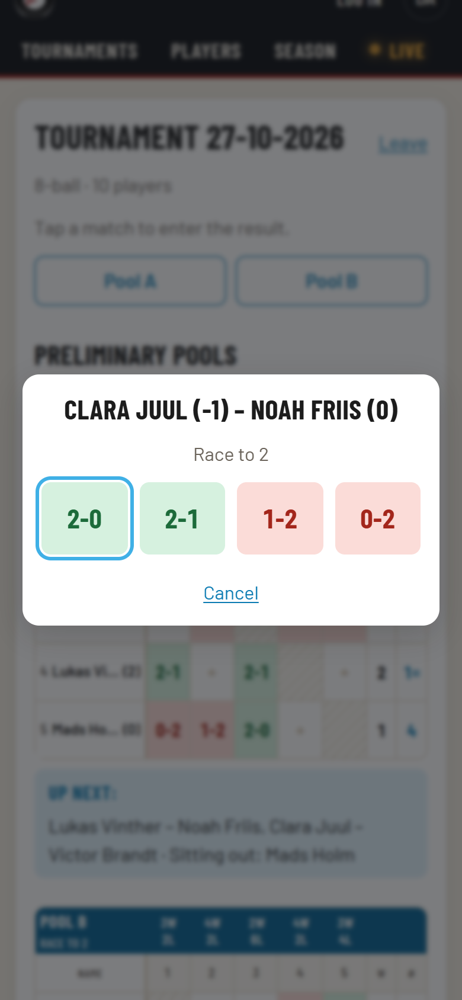
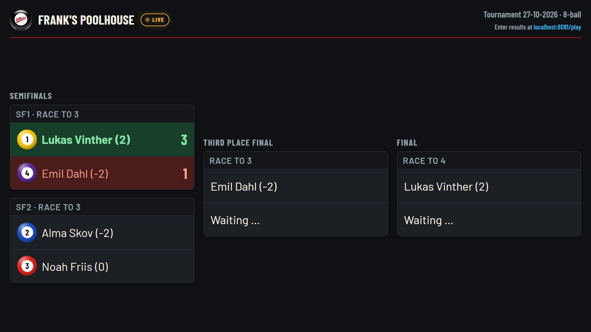
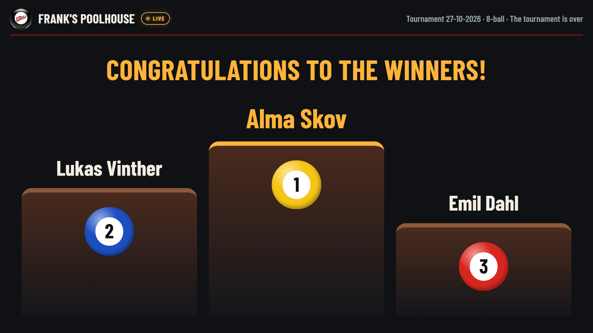

# Frank's Poolhouse — Tournament Platform

A web app that runs the weekly pool tournaments at Frank's Poolhouse in Odense, from the
pool draw to the season leaderboard. It replaced the club's Excel workbook and runs in
production at **[turneringsportal.kjaer-thomsen.dk](https://turneringsportal.kjaer-thomsen.dk)**.

Write-up: **[Building a Tournament Platform for My Local Pool Club](https://oskar.kjaer-thomsen.dk/blog/building-a-pool-tournament-platform)**



*The screenshots use made-up players, not the club's real data.*

## What it does

- **Setting up:** the tournament director adds tonight's players, the app draws them into
  pools, and the director can rearrange the pools by drag and drop before play starts.
- **Playing:** players enter their own results on their phones at `/play`, with a six-digit
  code from the director. Pool tables, standings and "Up next" update for everyone at once.
- **On the TV:** a flatscreen in the club shows `/live`: the pools during pool play, the bracket
  during the knockout, a podium at the end, and the season leaderboard between tournaments.
- **Afterwards:** the knockout is seeded from the pools, and concluding a tournament gives
  every player a placement, season points (with a member bonus) and a handicap review.

The interface is in Danish and English.

| Setting up | Playing on a phone |
|---|---|
|  |   |

| Knockout on the TV | When the tournament is concluded |
|---|---|
|  |  |

## Architecture

A TypeScript monorepo (npm workspaces) with three packages:

| Package | What it is |
|---|---|
| `packages/core` | The tournament rules as pure functions with no I/O: pool splits and draws, round-robin schedules, standings, qualification, seeding, the bracket, placements, points, seasons and handicaps |
| `apps/server` | A Fastify REST API on PostgreSQL (Drizzle ORM), with Server-Sent Events for live updates. It also serves the built frontend, so the app is one container |
| `apps/web` | A React app built with Vite, using TanStack Query and dnd-kit |

Both the server and the frontend use `core`, so each rule lives in one place. Randomness, such as
the pool draw, is passed into the functions, so tests use a seeded generator.

## Design decisions

- **Ties are flagged, not guessed.** Players are ranked by matches won, frame difference and
  head-to-head (a mini-league for three or more). Ties that can't be broken, like A > B > C > A,
  are flagged and the director orders them.
- **Live updates carry no state.** A Server-Sent Event only says which tournament changed, and
  every open page refetches. The first event also carries a version hash, so the TV reloads
  itself after a deploy.
- **A screen nobody can scroll.** `/live` is exactly one screen high and scales its content to
  fit, in a dark theme for a dim bar.
- **A code instead of player accounts.** Each tournament gets a six-digit code that only admins
  see; it never appears on the TV. Players can only fill in matches without a result, the first
  result counts, and join attempts are rate limited.
- **Rules enforced by the database too.** A partial unique index allows only one tournament in
  progress. Admin accounts can only be created with a CLI on the server; there is no sign-up
  route.

The full rules as implemented, and a decisions log, are in [DOCUMENTATION.md](DOCUMENTATION.md).

## Running it locally

Requires Node.js 24 and Docker.

**Everything in Docker:**

```sh
cp .env.example .env
docker compose up -d --build      # http://localhost:8080
docker compose exec app node apps/server/dist/cli/admin.js create <username>
```

**For development:**

```sh
cp .env.example .env
npm install
docker compose up -d db           # Postgres on localhost:5432
npm run dev -w @franks/server     # API on http://localhost:3000
npm run dev -w @franks/web        # http://localhost:5173, proxies /api to the server
```

The server applies database migrations on startup.

## Tests

```sh
npm test            # every workspace
npm run typecheck
npm run lint
```

The rules in `core` are unit tested with the club's own workbook results as fixtures. The API is
covered by integration tests against a real PostgreSQL database (a separate `franks_test`
database, so `docker compose up -d db` must be running). More than 260 test cases, run with
Vitest.

## Deployment

The app is built into one Docker image (multi-stage build). In production it runs on a Linux
server with Docker Compose, next to PostgreSQL and a container that takes nightly database
dumps. HTTPS comes from a Caddy reverse proxy shared with other sites on the server. Updating
is `git pull && docker compose up -d --build`. See [DOCUMENTATION.md](DOCUMENTATION.md) for the
full setup.
